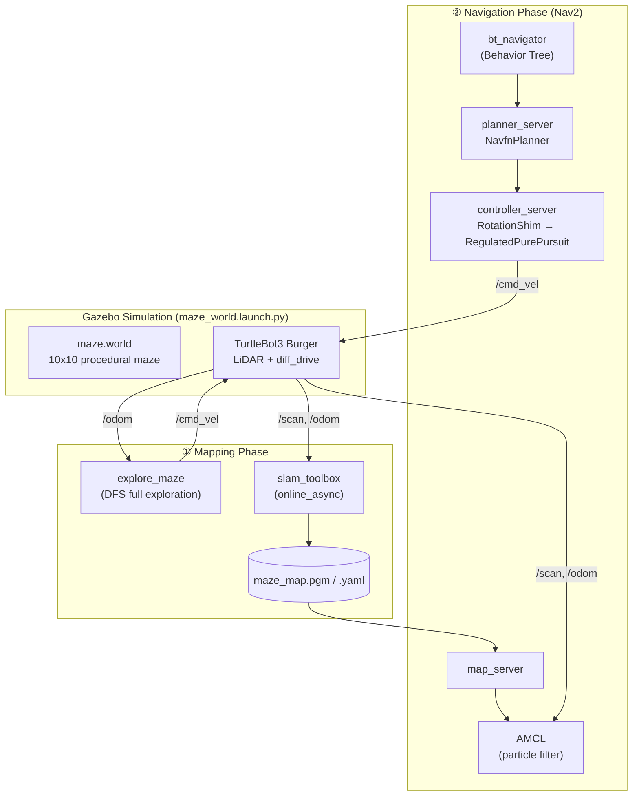

# 🧭 maze-escape

**SLAM + Nav2 기반 미로 자율 탐사·탈출 로봇 (ROS2 Humble / Gazebo / TurtleBot3)**


라이다를 단 TurtleBot3가 **절차적으로 생성된 미로를 사람의 조작 없이 완전탐색하며 지도를 만들고(SLAM)**, 완성된 지도 위에서 **임의의 목표 지점까지 자율주행(Nav2)** 하는 시뮬레이션 프로젝트입니다.

<!-- TODO: 데모 GIF 추가 (매핑 과정 / Nav2 주행 과정). 예: docs/mapping.gif, docs/navigation.gif -->
<!--
| SLAM 매핑 (자율 완전탐색) | Nav2 자율주행 |
| :---: | :---: |
|  |  |
-->

---

## 📌 Overview

| 항목 | 내용 |
| --- | --- |
| 기간 / 인원 | 2026 / 개인 프로젝트 (설계·구현·검증 전 과정) |
| 환경 | Ubuntu 24.04 호스트 + Docker(ROS2 Humble), Gazebo Classic 11 |
| 로봇 | TurtleBot3 Burger (2D 360° LiDAR, 차동구동) |
| 핵심 기술 | 랜덤 Prim's 미로 생성, DFS 완전탐색, slam_toolbox, AMCL, Nav2 (NavFn + RotationShim + RegulatedPurePursuit) |
| 언어 | Python (rclpy) / C++ (rclcpp) 포팅은 별도 진행 |

### 배경

학부 과제로 ROS1에서 만든 *"아두이노 조이스틱으로 사람이 직접 로봇을 조종해 제한시간 안에 미로를 탈출하는 게임"* 을 ROS2로 다시 구현하면서,
**사람이 조종하던 문제를 로봇이 스스로 인지·판단·제어로 해결하도록** 발전시켰습니다.

| 자율주행 단계 | 이 프로젝트에서 |
| --- | --- |
| 인지 (Perception) | LiDAR(`/scan`) + 오도메트리(`/odom`), SLAM / AMCL 위치추정 |
| 판단 (Planning) | 전역 경로계획(NavFn), 행동 트리 기반 주행·복구 흐름 |
| 제어 (Control) | RegulatedPurePursuit 경로 추종 → `/cmd_vel` |

---

## 🏗️ System Architecture



### 두 단계로 나눈 이유

| 단계 | 목적 | 지도 | 위치추정 |
| --- | --- | --- | --- |
| ① 매핑 | 미로 전체를 스캔해 지도 완성 | 계속 갱신 | 스캔 매칭 (SLAM) |
| ② 자율주행 | 완성 지도 위에서 목표 지점까지 이동 | 고정 (읽기 전용) | AMCL |

"환경을 한 번 매핑 → 저장된 지도로 반복 주행"은 창고·청소 로봇 등 실제 배포 로봇의 표준 워크플로우이자,
**정밀 지도를 사전에 구축하고 그 위에서 위치를 추정하는 HD맵 기반 자율주행 구조의 축소판**입니다.

### TF Tree

```
map ──▶ odom ──▶ base_footprint ──▶ base_link ──▶ base_scan
 ↑SLAM/AMCL  ↑diff_drive plugin      ↑robot_state_publisher (URDF)
```

### 주요 토픽 / 액션

| 이름 | 타입 | 흐름 |
| --- | --- | --- |
| `/scan` | sensor_msgs/LaserScan | Gazebo LiDAR → slam_toolbox, AMCL, costmap |
| `/odom` | nav_msgs/Odometry | diff_drive → explore_maze, slam_toolbox, Nav2 |
| `/cmd_vel` | geometry_msgs/Twist | explore_maze 또는 Nav2 controller → 로봇 |
| `/map` | nav_msgs/OccupancyGrid | slam_toolbox / map_server → costmap, RViz |
| `navigate_to_pose` | nav2_msgs/action/NavigateToPose | RViz Nav2 Goal → bt_navigator |

---

## ⚙️ Implementation

### 1. 절차적 미로 생성 — 랜덤 Prim's 알고리즘

미로를 **그래프의 스패닝 트리**(모든 칸 도달 가능 + 루프 없음)로 보고, 무작위 스패닝 트리 생성 문제로 환원했습니다.

1. 모든 칸이 벽으로 막힌 그리드에서 시작
2. 방문한 칸의 미방문 이웃을 frontier에 추가
3. frontier에서 무작위로 하나를 뽑아 방문한 이웃과의 벽을 허물고 방문 처리
4. frontier가 빌 때까지 반복

| | **Randomized Prim's (선택)** | Recursive Backtracking |
| --- | --- | --- |
| 결과 | 짧은 가지가 많고 분기·꺾임이 많음 | 길고 구불구불한 복도 위주 |
| 선택 이유 | 갈림길이 많아 탐색·경로계획 검증에 적합 | |

- 10x10 그리드, 복도 폭 1m, `SEED=42`로 같은 미로를 재현 가능
- Gazebo `.world`(SDF)로 자동 변환: 각 벽에 `collision` + `visual` 정의
- **벽 병합 최적화**: 같은 줄의 연속된 벽을 하나의 박스로 합쳐 모델 수 **120개 → 53개**로 축소

### 2. 자율 완전탐색 — DFS (`explore_maze`)

SLAM 지도를 완성하려면 로봇이 **모든 통로를 빠짐없이** 지나가야 합니다. 빠진 영역은 지도에 "미지(unknown)"로 남아 Nav2가 경로를 계획할 수 없기 때문입니다.

- 미로 생성과 **같은 SEED**로 스패닝 트리를 복원 → 시뮬레이션 미로와 탐색 경로가 항상 일치
- 트리에서 DFS를 하면 모든 엣지를 한 번씩 왕복 → 칸 100개, 엣지 99개 × 2 + 시작 칸 = **웨이포인트 199개**
- `/odom` 피드백으로 **회전 → 직진**을 반복하는 10Hz 제어 루프로 `/cmd_vel` 발행
  - 다음 웨이포인트와의 방향 오차가 0.05rad보다 크면 제자리 회전(0.8rad/s), 작으면 직진(0.18m/s)
  - 웨이포인트까지 0.08m 이내로 들어오면 다음 웨이포인트로 전환
- 공통 로직(`carve_maze`, `dfs_walk`)을 `maze_grid.py`로 분리해 미로 생성과 탐색이 공유

> **설계 판단**: 매핑 단계에는 완성된 지도가 없어서 Nav2 대신 단순한 odom 기반 제어를 사용했고, 장애물 회피가 없다는 한계 때문에 역할을 **"지도 완성 전용"으로 한정**했습니다. 실제 주행은 Nav2가 담당합니다.

### 3. SLAM — slam_toolbox (online_async)

- 그래프 기반 2D SLAM: 스캔 매칭 → 포즈 그래프 → 루프클로저 → 그래프 최적화
- `online_async`: 주행하면서 실시간 매핑, 처리가 밀리면 최신 스캔을 우선 처리
- 평면 차동구동 로봇 + 높이 변화 없는 미로이므로 2D LiDAR SLAM으로 충분하다고 판단
- 결과 지도를 `maze_map.pgm` / `maze_map.yaml`로 저장

### 4. 자율주행 — Nav2

| 구성 요소 | 설정 |
| --- | --- |
| 위치추정 | AMCL (파티클 필터), `/initialpose`로 초기 위치 지정 |
| 전역 경로계획 | NavfnPlanner (`use_astar: false` → Dijkstra) |
| 지역 경로추종 | **RotationShimController → RegulatedPurePursuitController** (기본 DWB에서 교체) |
| RPP 설정 | `desired_linear_vel` 0.18m/s, `lookahead_dist` 0.4m (0.3~0.6m) |
| RotationShim 설정 | 경로 방향과 1.2rad(약 69°) 이상 차이 나면 1.0rad/s로 먼저 제자리 회전 |
| Costmap | `robot_radius` 0.1m, obstacle / voxel / inflation layer (global은 static layer 추가), `inflation_radius` 0.3m |
| Progress checker | 제자리 회전을 고려해 `required_movement_radius` 0.3m, `movement_time_allowance` 30s |

### 5. C++ 포팅

자율주행 업계의 주 언어인 C++ 경험을 위해, 주기적으로 odom을 받아 속도 명령을 내는 제어 노드(`maze_grid`, `explore_maze`)를 **rclcpp**로 포팅하는 작업을 별도 패키지로 진행했습니다. (Node 클래스, 타이머, 콜백, CMake/ament 빌드) 이 저장소에는 Python 버전만 포함되어 있습니다.

---

## 🔧 Troubleshooting

### ⭐ 1. 루프클로저 오탐 (Perceptual Aliasing)

| | |
| --- | --- |
| **문제** | 정상 주행 중 특정 위치에서 SLAM 추정 위치가 튀며 지도가 겹치고 깨짐 |
| **원인** | 미로가 1m 그리드로 완전히 균일해서 서로 다른 복도·모서리가 LiDAR상 거의 동일하게 보임 → 루프클로저가 다른 두 위치를 같은 곳으로 오인 |
| **해결** | 루프클로저 인정 기준을 엄격하게 재튜닝 |
| **트레이드오프** | 진짜 루프클로저 기회도 일부 놓칠 수 있으나, 잘못된 보정으로 지도 전체가 오염되는 것을 막는 것을 우선 |

| 파라미터 | 기본값 → 조정값 |
| --- | --- |
| `loop_match_minimum_response_coarse` | 0.35 → **0.55** |
| `loop_match_minimum_response_fine` | 0.45 → **0.65** |
| `loop_search_maximum_distance` | 3.0 → **1.5** m |
| `loop_search_space_dimension` | 8.0 → **4.0** m |

> 창고 통로, 터널, 동일 구조의 주차장처럼 **반복 구조 환경에서 실제로 발생하는 문제**를 시뮬레이션에서 재현하고 해결한 경험입니다.

### ⭐ 2. 좁은 복도에서 DWB 컨트롤러 정지

| | |
| --- | --- |
| **문제** | 1m 폭 복도에서 로봇이 결정을 못 내리고 거의 정지, `Failed to make progress` 반복 |
| **원인** | DWB는 (v, ω) 후보 궤적을 샘플링해 점수로 비교하는데, 좁은 공간에서는 유효한 후보가 적고 점수가 비슷해 멈칫거림 |
| **해결** | 경로 위 look-ahead 점을 향해 곡률(κ = 2y / L²)로 조향하는 **RegulatedPurePursuit**로 교체. 장애물 회피 약점은 costmap 기반 전역 경로로 보완 |

### ⭐ 3. 반대 방향 목표에서 제자리 회전 실패

| | |
| --- | --- |
| **문제** | 로봇 뒤쪽에 목표를 주면 회전 도중 멈춤 |
| **원인** | ① 후진 비활성(`min_vel_x: 0.0`)이라 반드시 회전으로 방향 전환 ② inflation이 복도 폭에 비해 커서 복도 전체가 고비용 ③ **progress_checker가 위치 이동만 진행으로 인정** → 제자리 회전을 정지로 오판 |
| **해결** | `RotationShimController` 추가(1.2rad 이상 차이 시 먼저 제자리 회전), `inflation_radius` 0.3m, `movement_time_allowance` 10 → 30s |
| **결과** | 에러 0건, 반대 방향 목표도 회전 후 도착 |

### ⭐ 4. 미로 확장 시 심각한 렌더링 렉

| | |
| --- | --- |
| **문제** | 10x10 미로에서 gzclient CPU 100~250%, 화면 멈춤 |
| **1차 시도** | 벽 병합(120 → 53개): 효과는 있으나 근본 해결 아님 |
| **진짜 원인** | 초기 GUI 문제를 우회하려고 켜둔 **소프트웨어 렌더링**(`LIBGL_ALWAYS_SOFTWARE=1`). GPU 드라이버 문제가 아니라 컨테이너에 `/dev/dri`가 전달되지 않았던 것 |
| **해결** | `/dev/dri` 전달 + 소프트웨어 렌더링 제거 → `glxinfo`로 GPU 렌더링 확인 → **CPU 약 5%** |
| **배운 점** | 임시 우회책이 나중에 다른 문제의 원인이 될 수 있다. 증상 완화보다 근본 원인을 다시 점검해야 한다 |

<details>
<summary><b>기타 트러블슈팅</b></summary>

| 문제 | 원인 | 해결 |
| --- | --- | --- |
| Gazebo GUI 미표시 | Docker X11 연결 누락, `/dev/shm` 64MB 부족 | X11 소켓 마운트 + `DISPLAY` + xhost, `shm_size: 2gb` |
| 로봇 스폰 실패 | `/spawn_entity` 서비스 등록(20~30s)과 스폰 대기시간(30s) 간 레이스 컨디션 | `ros2 service list`로 서비스 확인 후 재스폰 |
| 강제 이동 시 SLAM 지도 손상 | SLAM은 연속 이동을 가정하는데 순간이동은 오도메트리가 모름 | slam_toolbox 노드만 재시작 |
| 미관측 영역 목표 시 Nav2 실패 | 한 번도 스캔되지 않은 unknown 영역은 경로계획 불가 | 지도에 기록된 영역으로 목표 변경 → 복구 0회 도착 |
| AMCL 위치 불일치 | 장시간 주행으로 누적된 odom 드리프트 값을 초기 위치로 사용 | Gazebo ground truth(`gz model -m burger -i`)로 `/initialpose` 재설정 |
| 키를 떼도 계속 이동하는 teleop | 터미널은 key-release를 감지 못 함 | 입력이 일정 시간 없으면 정지하는 `hold_teleop` 노드 직접 구현 (개발 중 테스트용, 저장소 미포함) |

</details>

---

## 📊 Results

- `explore_maze`가 웨이포인트 199개를 자동 순회하며 **10x10 미로 전체 지도를 사람 개입 없이 완성**
- Nav2 주행 검증: 시작 (0.5, 0.5) → 반대편 출구 칸 (9.5, 9.5), **13m 이상 경로를 복구 동작 0회로 도착 (SUCCEEDED)**
- RViz Nav2 Goal로 임의의 시작·목표를 주어 벽을 피한 최단 경로 주행 확인

<!-- TODO: 반복 테스트 결과 표 추가 (총 시도 횟수, 성공률, 평균 도착 시간, 평균 복구 횟수) -->

---

## 🚀 How to Run

### 1. 환경

ROS2 Humble + Gazebo Classic + TurtleBot3 패키지(`turtlebot3_gazebo`, `turtlebot3_navigation2`), `slam_toolbox`, `nav2_bringup`이 필요합니다.

```bash
# 예시: Docker 컨테이너 (ROS2 Humble) — GUI와 GPU 렌더링을 위해 X11, /dev/dri 전달
xhost +local:docker
docker run -it --name ros2_humble \
  --env DISPLAY=$DISPLAY \
  --volume /tmp/.X11-unix:/tmp/.X11-unix \
  --device /dev/dri \
  --shm-size=2g \
  osrf/ros:humble-desktop
```

### 2. 빌드

```bash
mkdir -p ~/ros2_ws/src && cd ~/ros2_ws/src
git clone https://github.com/donggyu-143/maze-escape.git
cd ~/ros2_ws
rosdep install --from-paths src --ignore-src -y
colcon build --symlink-install
source install/setup.bash
export TURTLEBOT3_MODEL=burger
```

### 3. (선택) 미로 다시 생성

`worlds/maze.world`는 기본값(10x10, seed 42)으로 이미 생성되어 있습니다. 크기나 seed를 바꾸려면 저장소 폴더에서 실행한 뒤 다시 빌드합니다.

```bash
cd ~/ros2_ws/src/maze-escape
python3 generate_maze.py --width 10 --height 10 --seed 42 --output worlds/maze.world
```

> `explore_maze.py`의 `WIDTH`, `HEIGHT`, `SEED`도 같은 값으로 맞춰야 탐색 경로가 미로와 일치합니다.

### 4. 매핑 (SLAM)

```bash
# 터미널 1: 미로 월드 + 로봇 (시작 위치: 첫 칸 중심 (0.5, 0.5))
ros2 launch maze_escape maze_world.launch.py

# 터미널 2: SLAM
ros2 launch slam_toolbox online_async_launch.py \
  slam_params_file:=$HOME/ros2_ws/src/maze-escape/config/slam_params.yaml \
  use_sim_time:=true

# 터미널 3: 자율 완전탐색
ros2 run maze_escape explore_maze

# 탐색 완료 후 지도 저장
ros2 run nav2_map_server map_saver_cli -f ~/ros2_ws/src/maze-escape/maps/maze_map
```

### 5. 자율주행 (Nav2)

```bash
# 터미널 1: 미로 월드 + 로봇
ros2 launch maze_escape maze_world.launch.py

# 터미널 2: Nav2 (저장된 지도 + 튜닝한 파라미터)
ros2 launch turtlebot3_navigation2 navigation2.launch.py \
  use_sim_time:=true \
  map:=$HOME/ros2_ws/src/maze-escape/maps/maze_map.yaml \
  params_file:=$HOME/ros2_ws/src/maze-escape/config/nav2_params.yaml
```

RViz에서 `2D Pose Estimate`로 초기 위치(0.5, 0.5)를 지정한 뒤 `Nav2 Goal`로 목표를 찍으면 주행합니다.

---

## 📁 Project Structure

```
maze-escape/                     # ROS2 패키지 maze_escape (ament_python)
├── maze_escape/
│   ├── maze_grid.py             # 공통 로직: carve_maze (랜덤 Prim's), dfs_walk, cell_center
│   └── explore_maze.py          # DFS 웨이포인트 + odom 기반 회전→직진 제어 노드
├── generate_maze.py             # 미로 생성 → Gazebo SDF .world 출력 (연속 벽 병합)
├── launch/
│   └── maze_world.launch.py     # gzserver/gzclient + TurtleBot3 spawn + robot_state_publisher
├── worlds/
│   └── maze.world               # 생성된 10x10 미로 (seed 42, 벽 모델 53개)
├── config/
│   ├── slam_params.yaml         # slam_toolbox 파라미터 (루프클로저 기준 강화)
│   └── nav2_params.yaml         # Nav2 파라미터 (RotationShim + RPP, inflation 0.3m)
├── maps/
│   ├── maze_map.pgm             # SLAM으로 만든 점유 격자 지도 (해상도 0.05m)
│   └── maze_map.yaml
├── test/                        # ament 기본 린트 테스트
├── package.xml
└── setup.py
```

---

## 🧩 Limitations & Future Work

| 한계 | 개선 방향 |
| --- | --- |
| 탐색이 미로 구조를 안다고 가정 | **Frontier 기반 탐색**으로 미지 환경 대응 |
| 탐색 노드에 장애물 회피 없음 | 탐색 단계에도 Nav2 또는 LiDAR 기반 회피 적용 |
| 시뮬레이션만 수행 | 실물 적용 시 센서 노이즈·바퀴 슬립 대응을 위해 IMU 융합(EKF, `robot_localization`) |
| 반복 구조에서 루프클로저 오탐 | 환경 비대칭 표식 추가, 다중 센서 융합 |
| 정적 환경만 검증 | 동적 장애물 회피 테스트 |
| 사전 매핑된 영역만 주행 가능 | 탐색과 주행 동시 수행, 비전 기반 인식 결합 |

---

## 💡 What I Learned

- **알고리즘의 가정은 환경에 따라 깨진다**: 균일한 미로는 SLAM의 루프클로저 가정을, 좁은 복도는 DWB의 샘플링 가정을 깨뜨렸다. 기본 파라미터는 넓은 데모 환경 기준이므로 환경 특성을 이해하고 재조정해야 한다.
- **직접 만들기 전에 표준 도구를 찾는다**: 회전 실패 문제를 코드로 우회하지 않고 Nav2의 표준 플러그인(RotationShim)으로 해결했다.
- **임시 우회는 기술 부채가 된다**: 소프트웨어 렌더링 우회가 이후 렉의 원인이 된 경험에서 근본 원인 점검의 중요성을 배웠다.
- **ROS2 그래프로 디버깅한다**: RViz, `ros2 topic echo/hz`, `ros2 service list`, `ros2 param set`, 액션 피드백(`distance_remaining`, 복구 횟수)으로 "못 가는 곳"과 "가다가 생긴 문제"를 구분했다.

---

## 🛠️ Tech Stack

`ROS2 Humble` · `Gazebo Classic 11` · `TurtleBot3` · `slam_toolbox` · `Nav2` · `AMCL` · `RViz2` · `Python (rclpy)` · `Docker` · `Ubuntu`
